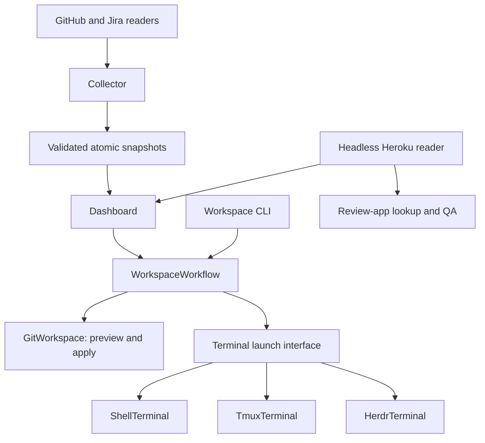

# Sidequest architecture

Queue evidence and explicit workspace actions have separate owners. The project
uses Python 3.9+ and the standard library; no plugin framework is required.

## Module ownership

| Module | Responsibility |
| --- | --- |
| `sidequest/application.py` | Shared prepare/start/open/agent use cases and explicit dependency composition |
| `sidequest/workspace.py` | Live Git inspection, naming, planning, revalidation and creation |
| `sidequest/terminal.py` | Common launch interface, shell handoffs and child execution |
| `sidequest/tmux.py` | Session-scoped pane matching, windows, selection and quoting |
| `sidequest/herdr.py` | Caller-workspace-scoped tab/pane discovery, layout and private agent launchers |
| `sidequest/environments.py` | Read-only Heroku authentication, pagination and status mapping |
| `collector.py` and `snapshots.py` | Shared collection, validation, atomic publication and last-good retention |
| `ticket-tui/plan_document.py` | Read-only Plan/Updates section partition and readable Markdown rendering |
| `ticket-tui/` | Input, rendering, background scheduling, UI state and curses handoff |

Terminal adapters receive a selected directory and optional argument vector. They
have no Git lifecycle or ticket/deployment transport dependency. Agents are
configured executable arguments, without their own workspace policy. Skills call
supported helper commands instead of duplicating that policy.

`WorkspaceWorkflow` receives a Git workspace module and terminal adapter.
`build_workflow(settings, environ, run)` captures repository, destination, base,
shell, agent command, terminal mode and managed context once per workflow. Later changes to its
input dictionaries cannot redirect it. The CLI composes once per invocation;
the dashboard composes once per explicit action and accepts an injected factory.
Other queue/transport modules still use process-wide configuration. This is not
whole-application multi-profile support.

## Planning, execution and presentation

`GitWorkspace.preview(...)` returns an immutable `WorkspacePlan` without mutation.
`apply(plan)` repeats inspection and compares repository, checkout, branch,
destination and source commit evidence. Stale plans require a new preview.
Existing destinations are never overwritten. Existing checkouts are reused
without switching the caller's branch. Normal Git upstream setup is preserved.

Revalidation is not an atomic lock over other Git processes. Git rejects branch,
path and checked-out-branch conflicts at execution, but a source ref can advance
between validation and Git's operation. No fetch, reset, removal, cleanup, secret
copying or automatic sync is implemented by this interface.

`LaunchResult` contains a foreground request or display message, plus workspace
evidence for a ticket start. Git/tmux actions run in background jobs. Results
cross the UI event queue; only the UI thread updates SQLite and suspends/restores
curses. Interactive children inherit terminal I/O after the handoff. Their exit
status reaches the caller.

## Compatibility and migration limits

Workspace CLI flags/output, default preview, configured base and explicit `--open`
remain. Space n and CLI `--open` keep opening foreground shells even inside tmux.
Other in-tmux navigation and agent launches keep their existing behavior.
Compatibility helpers in `workspace.py`, `ticket-tui/launcher.py` and
`ticket-tui/environments.py` delegate to package implementations. Headless modules
never import those UI shims.

Herdr 0.9.5 is implemented with managed-context checks and explicit selection.
Auto prefers active tmux, then active Herdr, then shell. Herdr validates structured
responses and returned IDs within the caller's workspace. Agent launch writes a
private self-removing script outside the repo to avoid canonical shell input limits;
uncertain requests are never retried automatically. The adapter reports submission,
not agent completion. Full portable `tw` startup remains planned in
[the integration spec](specs/workspace-integrations.md). Heroku now belongs
to the headless package, but dashboard refresh/cache labels remain provider-specific.
A second deployment provider must introduce normalized evidence and shared
freshness handling in the same change. Review-app QA retains its Heroku host rules.

The existing Jira executable transport, CLI dispatcher and snapshot/SQLite
compatibility loading remain separate migration work. None requires a speculative
registry, event bus or new dependency to add a terminal adapter.

## Verification

Run `./bin/check`. Specs use real temporary Git repositories, injected terminal
runners, fictional service responses and headless subprocesses. Existing CLI and
real PTY tests protect user-visible behavior. Native tmux/Herdr and live providers
need separate verification; offline checks do not certify them.
