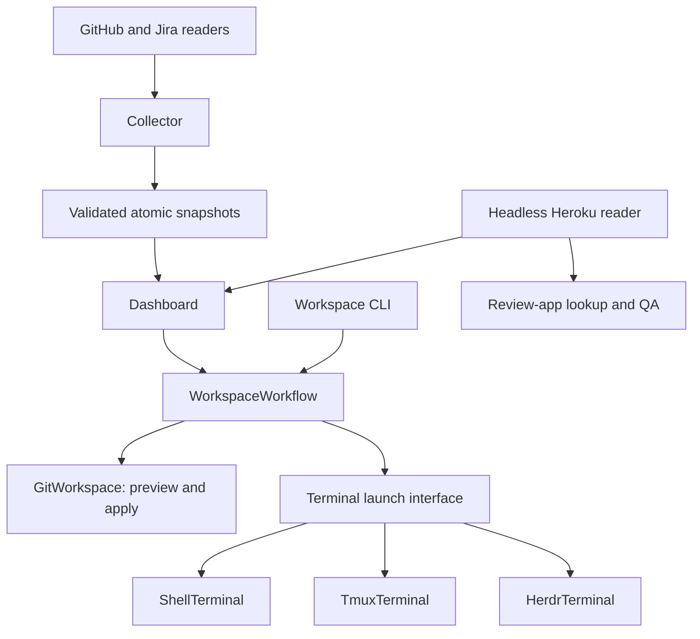

# Sidequest architecture

Queue evidence and explicit workspace actions have separate owners. The project
uses Python 3.9+ and the standard library; no plugin framework is required.

## The parts

Sidequest is one app with three entry points and six parts underneath. A part may
use the parts below it in this list, never the ones above it; the dashboard and the
command line share everything from "Use cases" down.

| Part | What it owns | Files |
| --- | --- | --- |
| Entry points | What you run: the dashboard, `sidequest up`, `sidequest start`, `sidequest projects`, headless commands, the app booking | `bin/sidequest` (+ `bin/sidequest-up.py`, `bin/sidequest-start.py`, `bin/sidequest-projects.py`), `bin/sidequest-data` (+ `bin/sidequest-*.py` helpers), `bin/sqapp` |
| Dashboard | Drawing the queue and detail tabs, keys, background jobs, curses handoff | `ticket-tui/tui.py`, `layout.py`, `detail_views.py`, `plan_document.py`, `sorting.py` |
| Queue rules | Whose turn it is, lanes, stages, standup, local branch state; no curses, no writes | `ticket-tui/core.py`, `workflow.py`, `activity.py`, `worklog.py`, `standup.py`, `branch_state.py`, `queue_evidence.py` |
| Agent workflows | The skills, per-ticket files (plan, questions, QA evidence) and their helpers | `agents/skills/`, `sidequest/skills.py`, `questions.py`, `qa.py`, `bin/sidequest-{plan-init,ship-check,pr-body-check,qa-shot,feedback,questions,review-app,worktree}.py` |
| Use cases | One call per action, shared by the dashboard and the commands: prepare, start, open, agent; `sidequest start` from a shell | `sidequest/application.py`, `start.py`, `overview.py` (the project overview's rows, lines and keys) |
| Local workspace (Git) | Finding, naming, planning and creating worktrees; the app booking lock | `sidequest/workspace.py`, `workspaces.py`, `worktrees.py`, `repository.py`, `app_booking.py` |
| Terminals | Shell handoff, tmux and Herdr windows and panes; no Git | `sidequest/terminal.py`, `tmux.py`, `herdr.py`, `herdr_session.py`, `terminal_mode.py` |
| Data | Collecting each source once, keeping the last good copy, atomic snapshots | `sidequest/collector.py`, `snapshots.py`, `evidence.py` |
| Services | Talking to Jira, GitHub and Heroku; read-only except the opt-in Jira start move | `bin/sidequest-jira.py` (+ `sidequest/jira.py`), `sidequest/github.py`, `services.py`, `environments.py`, `review_apps.py`, `reviews.py`, `access.py` |
| Settings | Shared and per-project settings, the project choice, secrets by reference, identity, ticket keys | `sidequest/config.py`, `project_flag.py`, `credentials.py`, `projects.py`, `identity.py`, `ticket_keys.py` |

Outside the app: your settings and skill files in `~/.config/sidequest/`, secrets in the
Keychain or environment, and data in `~/.local/{share,state}/sidequest/`. A project's own
tools (for example a company's command-line helpers) stay in that project's repositories and
reach Sidequest only through settings (commands, report view, skill replace versions).

## Module ownership

| Module | Responsibility |
| --- | --- |
| `sidequest/application.py` | Shared prepare/start/open/agent use cases and explicit dependency composition |
| `sidequest/workspace.py` | Live Git inspection, naming, planning, revalidation and creation |
| `sidequest/terminal.py` | Common launch interface, shell handoffs and child execution |
| `sidequest/tmux.py` | Session-scoped pane matching, windows, selection and quoting |
| `sidequest/herdr.py` | Caller-workspace-scoped tab/pane discovery, layout and private agent launchers |
| `sidequest/herdr_session.py` | `sidequest up` sessions in Herdr: workspace per session, tab per window, server start, attach |
| `sidequest/terminal_mode.py` | Picks tmux or Herdr for sessions (`workspace.terminal`, context) and one interface over both |
| `sidequest/environments.py` | Read-only Heroku authentication, pagination and status mapping |
| `sidequest/ticket_keys.py` | Every ticket key question: valid key, PR ticket, branch keys and branch ticket, mentions in text, leading-key removal |
| `sidequest/repository.py` | One rule for the workspace repository: an existing SIDEQUEST_REPO folder, else workspace.repository; no config import |
| `sidequest/app_booking.py` | The shared local app's lock line, expiry and header label; `bin/sqapp` writes it, the dashboard reads it |
| `sidequest/config.py` | Settings: shared config.json, the selected project profile over it, then SIDEQUEST_* variables; per-project storage |
| `sidequest/credentials.py` | Secrets by reference (environment, Keychain item or variable name); settings never hold a value |
| `sidequest/projects.py` | `project init` (a profile from config.example.json) and `project check` (what is set and what works) |
| `sidequest/skills.py` | `skill NAME`: generic skill, project commands, additions or the project's replace version; installed stubs |
| `sidequest/access.py` | AccessFailure: a failed service request with its cause; recovery text; word-based guessing only for text-only tools |
| `collector.py` and `snapshots.py` | Shared collection, validation, atomic publication and last-good retention |
| `ticket-tui/plan_document.py` | Read-only Plan/Updates section partition and readable Markdown rendering |
| `ticket-tui/queue_evidence.py` | Queue data: newest copy at startup, refresh validation, merging and saving updates, per-source failure sets |
| `ticket-tui/detail_views.py` | Every detail tab as styled rows (text plus a style name), Heroku status labels, the plan file cache and wrapping |
| `ticket-tui/` | Input, rendering, background scheduling, UI state and curses handoff |

Terminal adapters receive a selected directory and optional argument vector. They
have no Git lifecycle or ticket/deployment transport dependency. Agents are
configured executable arguments, without their own workspace policy. Skills call
supported helper commands instead of duplicating that policy.

`WorkspaceWorkflow` receives a Git workspace module and terminal adapter.
`build_workflow(settings, environ, run)` captures repository, destination, base,
shell, agent command, terminal mode and managed context once per workflow. Later changes to its
input dictionaries cannot redirect it. The CLI composes once per invocation;
the dashboard composes once per explicit action and accepts an injected factory.
Other queue/transport modules still use process-wide configuration. This is not
whole-application multi-profile support.

## Planning, execution and presentation

`GitWorkspace.preview(...)` returns an immutable `WorkspacePlan` without mutation.
`apply(plan)` repeats inspection and compares repository, checkout, branch,
destination and source commit evidence. Stale plans require a new preview.
Existing destinations are never overwritten. Existing checkouts are reused
without switching the caller's branch. Normal Git upstream setup is preserved.

Revalidation is not an atomic lock over other Git processes. Git rejects branch,
path and checked-out-branch conflicts at execution, but a source ref can advance
between validation and Git's operation. No fetch, reset, removal, cleanup or automatic
sync is implemented by this interface. A new worktree receives only the files listed in
workspace.copy_files: relative paths, regular files (not symlinks), never over an existing file.

`LaunchResult` contains a foreground request or display message, plus workspace
evidence for a ticket start. Git/tmux actions run in background jobs. Results
cross the UI event queue; only the UI thread updates SQLite and suspends/restores
curses. Interactive children inherit terminal I/O after the handoff. Their exit
status reaches the caller.

## Compatibility and migration limits

Workspace CLI flags/output, default preview, configured base and explicit `--open`
remain. CLI `--open` keeps opening a foreground shell even inside tmux; since 2026-11-09 Space n
in tmux mode selects or creates the ticket's window instead (`start(..., window=True)`).
Other in-tmux navigation and agent launches keep their existing behavior.
Compatibility helpers in `workspace.py` delegate to package implementations.
The dashboard reaches tmux only through WorkspaceWorkflow, and imports Heroku reading
and browser opening from the package directly;
the former `ticket-tui/launcher.py` and `ticket-tui/environments.py` are removed. Headless modules
never import those UI shims.

Herdr 0.9.5 is implemented with managed-context checks and explicit selection.
Auto prefers active tmux, then active Herdr, then shell. Herdr validates structured
responses and returned IDs within the caller's workspace. Agent launch writes a
private self-removing script outside the repo to avoid canonical shell input limits;
uncertain requests are never retried automatically. The adapter reports submission,
not agent completion. Full portable `tw` startup remains planned in
[the integration spec](specs/workspace-integrations.md). Heroku now belongs
to the headless package, but dashboard refresh/cache labels remain provider-specific.
A second deployment provider must introduce normalized evidence and shared
freshness handling in the same change. Review-app QA retains its Heroku host rules.

The existing Jira executable transport, CLI dispatcher and snapshot/SQLite
compatibility loading remain separate migration work. None requires a speculative
registry, event bus or new dependency to add a terminal adapter.

## Verification

Run `./bin/check`. Specs use real temporary Git repositories, injected terminal
runners, fictional service responses and headless subprocesses. Existing CLI and
real PTY tests protect user-visible behavior. Native tmux/Herdr and live providers
need separate verification; offline checks do not certify them.
