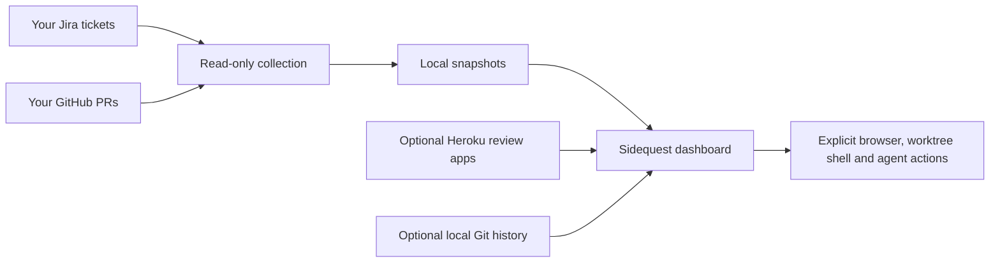

# Sidequest

Your terminal quest log for Jira tickets, GitHub pull requests and the work between
them. Sidequest shows whose turn it is, what changed, and what needs attention.
It also bundles optional agent skills and scripts for planning, local worktrees,
QA screenshots, review feedback and preparing PRs.

## Minimum requirements

For the GitHub + Jira dashboard, you need:

- A macOS or Linux terminal with Python 3.9+.
- Git and the GitHub CLI (`gh`), signed in with your own account.
- Your Jira site/email settings and your own API token in `SIDEQUEST_JIRA_TOKEN`.

Curses and SQLite are included with the supported Python installation; there are
no pip packages or separate database server to install for Sidequest.

**You do not need tmux, Neovim, `glow`, or custom commands such as `edge` and
`nvimc`. No macOS Keychain or clipboard setup is required for the dashboard.**
You can use your normal shell, editor and browser. Opening ticket/PR links uses
the operating system's default browser, or the command in `workspace.browser`.

An AI assistant is required only when you choose to run an agent workflow; its
CLI is configurable. Chrome, Chromium or Edge is required only for automated QA
screenshots, without any custom browser alias. Heroku authentication is used only
for the Heroku integration. Docker, Rails and application test tools belong to
the project you are working on and are not dashboard requirements.

On systems without macOS `pbcopy`, use `./bin/sidequest --standup` to print the
standup for normal terminal copying. The demo works without service credentials.

## Try it first

You need Python 3.9+ and a macOS or Linux terminal. The application uses only
Python's standard library; there is nothing to install with pip.

```sh
git clone https://github.com/Jackson201325/sidequest.git
cd sidequest
./bin/sidequest --demo
```

The demo contains fictional tickets and uses an in-memory database. No accounts,
network access or agent installation are needed. Use `j/k` to move, Enter for
details, `1`–`4` for lanes, `?` for help and `q` to quit.

To print the demo in a regular terminal:

```sh
./bin/sidequest --demo --list
```

## How it works

Sidequest runs on your computer and contacts your services directly. There is no
shared Sidequest account, hosted backend or server to deploy. Each downloader
supplies their own credentials and can see only what those accounts can access.



There are three parts:

| Part | What it does | Required for the dashboard? |
| --- | --- | --- |
| `bin/sidequest` | The interactive dashboard and text/standup views | Yes |
| `bin/sidequest-data` and the `sidequest/` package | Collect service data, normalize it and keep local snapshots | Yes; already bundled |
| `agents/skills/` and workflow scripts | Start/planning, local worktrees, QA, shipping preparation and feedback | Optional |

The dashboard reads local snapshots on startup. Use `--refresh` or press `r` to
load current Jira and GitHub evidence. Configured Heroku status can load separately.
If a source fails, its last good data and timestamp remain visible with an error;
failure never becomes an apparently successful empty queue.

All dashboard helpers are bundled. Scripts from another checkout, private agent
skills and personal shell aliases are not needed. Additional tools are tied to
the particular action you choose:

| Action | Tools it needs |
| --- | --- |
| GitHub + Jira dashboard | Python, Git, gh, and your Jira API token |
| Create/open a worktree | Git and your normal terminal shell; tmux is not required |
| Run an agent workflow | Your chosen agent CLI, configured with workspace.agent_command |
| Capture QA screenshots | Chrome, Chromium or Edge and your test application's setup |
| Inspect Heroku review apps | Heroku CLI login or an explicit API token |
| Run application tests | That application's own tools; Sidequest does not supply a Docker stack |

## Connect your own accounts

Start with the services you use. With no configuration, the live queue is empty
and makes no service requests.

```sh
mkdir -p ~/.config/sidequest
cp config.example.json ~/.config/sidequest/config.json
```

Open `~/.config/sidequest/config.json` in your editor. Replace the placeholders and
remove sections you do not use. This is a minimal Jira + GitHub example:

```json
{
  "identity": {
    "display_name": "Your Name",
    "git_author": "Your Git Author Name",
    "timezone": "UTC"
  },
  "jira": {
    "site": "https://your-company.atlassian.net",
    "email": "you@example.com",
    "projects": ["APP"]
  },
  "github": {
    "repository": "your-org/your-application",
    "username": "your-github-login"
  }
}
```

Choose the repository whose pull requests you want in your queue. Jira and GitHub
work independently: keeping just one service section is fine.

### GitHub

Install the [GitHub CLI](https://cli.github.com/), then sign in with your account:

```sh
gh auth login
gh api user --jq .login
```

Set `github.repository` to `owner/repository`. Set `github.username` to your login;
if omitted, PR discovery uses the currently authenticated gh user. A configured
username is also useful for identifying your authored PR commits.

### Jira

Set `jira.site`, `jira.email` and, optionally, `jira.projects`. Create a token in
your [Atlassian account's security settings](https://id.atlassian.com/manage-profile/security/api-tokens)
with access to read the projects you want. Supply it to the shell where Sidequest
will run. This Bash/zsh example hides input and keeps the token out of history:

```sh
printf 'Jira API token: '
read -r -s SIDEQUEST_JIRA_TOKEN
printf '\n'
export SIDEQUEST_JIRA_TOKEN
```

The variable lasts for that shell session. Re-enter it in a new terminal or use
your own secret manager. Sidequest reads exported variables; it does not load
`.env` files automatically. Do not put the token in config.json or on GitHub.

`jira.account_id` can be omitted: Sidequest reads it from Jira's `/myself` endpoint.
For scoped API tokens, add your site's `jira.cloud_id` so the adapter can use the
Atlassian API gateway. A missing or rejected token leaves cached data intact.

### Heroku, optional

Install the [Heroku CLI](https://devcenter.heroku.com/articles/heroku-cli), run
`heroku login`, and put the review-app pipeline ID in `heroku.pipeline`.
Sidequest reads the token from that CLI login or `SIDEQUEST_HEROKU_TOKEN`.
A blank pipeline disables Heroku and avoids any Heroku credential lookup.

### Local Git and plans, optional

Set `workspace.repository` to the absolute path of the application checkout you
work on. Set `identity.git_author` to your Git author name to filter local commits.
Local history reads never fetch, reset or switch your repository.

Use Jira keys such as `APP-123` in PR titles and ticket branches so sources can be
associated. `workspace.plans_dir` chooses where `APP-123/plan.md` and its QA evidence
live. `workspace.worktrees_dir` optionally chooses where new worktrees are created.
Both belong outside source repositories.

## Your first live refresh

From the Sidequest directory, with the credentials above available:

```sh
./bin/sidequest-data collect --json
./bin/sidequest
```

Or refresh as the dashboard opens:

```sh
./bin/sidequest --refresh
```

For scripting and a standup draft:

```sh
./bin/sidequest --refresh --list
./bin/sidequest --standup
```

The queue includes your assigned open Jira tickets, your authored open PRs and
Jira details for tickets named in those PRs. It separates work into:

| Lane | Meaning |
| --- | --- |
| Needs me | Current evidence points to your next action |
| Waiting | Jira assignment or a handoff points to another owner |
| Clarify | The available evidence does not establish who acts next |

Activity shows Jira/GitHub events. Work log shows dated commit evidence. Plan reads
the ticket's external plan file. Flow summarizes the current workflow stage.
Standup drafts from evidence rather than estimating hours or inventing progress.

WAIT counts Monday–Friday, 09:00–17:00 in your configured timezone; one day means
eight working hours. Nights and weekends are excluded, holidays are not. Jira
status history and first assignment supply the clock; absent history uses a
labeled observation fallback. The Refreshed timestamp describes data freshness.

## Optional skills and workflow scripts

The dashboard works without installing skills. Use these when you also want an
agent to help perform the work. They follow the target repository's instructions,
test commands, branch conventions and environment booking rules.

| Skill | Use it for |
| --- | --- |
| `sidequest-start` | Read a ticket, reuse/create its worktree and write a plan |
| `sidequest-qa-local` | Check acceptance criteria and capture local QA evidence |
| `sidequest-qa-review-app` | Check an open PR on its Heroku review app |
| `sidequest-ship` | Review, test, prepare scoped commits and a PR |
| `sidequest-feedback` | Read complete review threads, fix issues and draft replies |
| `sidequest-triage` | Investigate a supplied error and reproduce it with fixtures |

In the dashboard, Space `s` runs a selected workflow through your configured agent
in the ticket's local worktree. Without tmux, the dashboard hands its terminal to
the agent and returns when it exits. The command defaults to `claude`; set
`workspace.agent_command` to `codex`, or another CLI command that accepts the prompt
as its final argument. Those instructions are bundled; global skill installation
is not required. When already inside tmux, existing window/pane navigation remains.

For direct use in Codex or Claude Code, preview an installation, then install:

```sh
# Codex; use ~/.claude/skills instead for Claude Code
./bin/sidequest-data skills --dest ~/.codex/skills
./bin/sidequest-data skills --dest ~/.codex/skills --apply
./bin/sidequest-data skills --dest ~/.codex/skills --check
```

The installer binds helpers to this clone's absolute paths. Keep the clone in
place. It detects drift and refuses to overwrite user-edited skills. In a new
agent session, invoke a skill by name, for example `$sidequest-start APP-123`.

The helper scripts are available without an agent:

```sh
./bin/sidequest-data ticket APP-123 --json --activity
./bin/sidequest-data branch-name APP-123 --summary "Validate input" --type Bug
./bin/sidequest-data worktree APP-123 --json
./bin/sidequest-data workspace APP-123 --summary "Validate input" --base origin/main
# Repeat with --apply only to create the previewed local worktree
./bin/sidequest-data workspace APP-123 --summary "Validate input" --base origin/main --open
./bin/sidequest-data plan-init APP-123 --summary "Validate input"
./bin/sidequest-data pr-feedback 42 --json --activity
./bin/sidequest-data ship-check --no-fetch --base origin/main --json
./bin/sidequest-data pr-body-check /path/to/pr-body.md
```

Run Git/PR checks inside the application's ticket checkout, invoking Sidequest's
helper by its absolute path if needed. Use the target project's actual base ref.
The workspace helper uses live Git state, previews by default, reuses existing
checkouts, and never removes worktrees or copies secret files.

### Work in a plain terminal

You do not need tmux. Set `workspace.repository` to your application checkout.
In the dashboard, Space `n` creates or reuses the selected ticket's worktree and
opens your normal shell there. `w` opens a shell in an existing ticket worktree.
Run your editor, test commands or coding assistant as usual. Type `exit` to return
to Sidequest. Starting a local worktree does not move the Jira ticket.

The CLI's `workspace ... --open` command creates/reuses the checkout and opens a
shell there as well. It uses `workspace.base_ref` (default `origin/main`) unless you
pass --base. A child program cannot change the caller's shell directory; --open
therefore starts a shell in the worktree. To change your current shell instead,
omit --open and use `cd` with the printed DIR path.

Sidequest does not bundle a company Docker stack, shared database booking service,
automatic worktree cleanup, Jira custom-field mapping or board-specific status
transitions. The skills use the project's own setup and ask before remote actions
unless already authorized. Nothing merges, deploys or sends messages on refresh.

### QA screenshots

Start the target app with its documented command and install Chrome, Chromium or
Edge. Put a specification at the ticket's external `APP-123/qa/shots.json`:

```json
{
  "base_url": "http://localhost:3000",
  "shots": [{
    "name": "01-home",
    "path": "/",
    "caption": "Open the home page and check the welcome message",
    "steps": [{"expect_text": "Welcome"}]
  }]
}
```

Adapt the paths, text and clicks to your app. If login is needed, supply your own
local test account through `SIDEQUEST_QA_EMAIL` and `SIDEQUEST_QA_PASSWORD` in the
environment. No default login is supplied. `SIDEQUEST_QA_BROWSER` selects a browser
executable when discovery is insufficient.

```sh
./bin/sidequest-data qa-shot APP-123
./bin/sidequest-data qa-shot APP-123 --pr-markdown
./bin/sidequest-data review-app APP-123 --json
./bin/sidequest-data qa-shot APP-123 --review-app
```

Review-app login uses `SIDEQUEST_REVIEW_EMAIL` and `SIDEQUEST_REVIEW_PASSWORD`,
only on the HTTPS Heroku host discovered for that PR. Screenshots and manifests
stay in `qa/` or `qa-review/`; failed checks save separate evidence in `failures/`.
No screenshots are uploaded automatically. Re-capture when UI changes make them stale.

## Keys

| Key | Action |
| --- | --- |
| `j/k`, arrows | Move through tickets or scroll details |
| `h/l`, Enter | Switch between the list and details |
| `1`–`4` | All, Needs me, Waiting, Clarify |
| `/` | Search |
| `a/p/v/s/f/u` | Activity, Plan, Overview, Work log, Flow, Standup |
| `o/O` | Choose or reverse a sort |
| `+/-`, `=` | Resize sections or reset the split |
| `r`, `e` | Refresh Jira/GitHub, or optional Heroku status |
| Space `j/o` | Open the ticket or PR in your configured/default browser |
| `w` | Open a shell in the worktree; inside tmux, jump to its existing window |
| Space `n` | Create/reuse a local ticket worktree and open a shell there |
| Space `s` | Run a bundled workflow or custom prompt with the configured agent |
| `y` | Copy standup with macOS pbcopy; --standup prints it on any platform |
| `?`, `q` | Help, quit |

## Configuration and local storage

`SIDEQUEST_CONFIG=/absolute/path/config.json` selects another config file. The
`XDG_CONFIG_HOME`, `XDG_DATA_HOME` and `XDG_STATE_HOME` conventions are supported.
`config.example.json` lists the available settings, including optional browser,
tmux session, local repository and artifact folders. The default timezone is UTC.

| Content | Default location |
| --- | --- |
| Configuration | `~/.config/sidequest/config.json` |
| UI cache | `~/.local/share/sidequest/tickets.sqlite3` |
| Snapshots | `~/.local/state/sidequest/snapshots/` |
| Plans and QA evidence | `~/.local/state/sidequest/tickets/APP-123/` |
| QA browser profile | `~/.cache/sidequest/qa-browser-profile/` |

`--data-dir` and `--snapshots` override dashboard storage. `workspace.plans_dir`
or `SIDEQUEST_TICKETS_DIR` overrides the plans/QA folder. Snapshots and screenshots
can contain private work information and remain outside the source repository.
Tokens are read from your environment or CLI login store and are not stored in
snapshots. The project contains an example configuration, never your live login.

`--update-report` updates the Standup section of a report you supply at
`reports/YYYY-MM-DD.md`, beside the snapshots directory. It preserves written text,
adds new Today items and saves a backup. If the report is missing it prints a draft
and exits 3. There is no scheduler or check-in service.

## Troubleshooting

| Symptom | What to check |
| --- | --- |
| Empty queue | Configure at least one service, then run --refresh; check the selected project/repository and authenticated user |
| Jira login error | Export SIDEQUEST_JIRA_TOKEN in this shell; verify jira.email, site and, for scoped tokens, cloud_id |
| GitHub login/access error | Run gh auth login; verify the repository and account permissions |
| Old rows after a failed refresh | Cached data is being retained; the error and source timestamp explain why |
| No local work log | Configure workspace.repository and identity.git_author |
| No Heroku status | Configure the correct pipeline and check the account's access; provisioned does not always mean Web up |
| Missing browser or QA login | Select SIDEQUEST_QA_BROWSER and provide the appropriate local/review test credentials |
| Skill drift | --check reports differences; preserve user edits rather than overwriting them |
| Native Windows | Use a macOS or Linux environment; native Windows curses is unsupported |

## Development and limits

```sh
./bin/check
```

Checks use temporary folders, fictional identities, mocked services, temporary Git
repositories and a real pseudo-terminal for curses input. Optional browser fixture
tests run when `SIDEQUEST_QA_BROWSER` is provided directly to `test_qa_shot.py`.
See [DEVELOPMENT.md](DEVELOPMENT.md) and [HARDENING.md](HARDENING.md).

PR collection requires fewer than 100 authored open PRs; reaching the limit fails
explicitly and preserves the previous source. GitHub activity and unresolved threads
are paginated; reaching the REST API's 250-commit PR cap also fails explicitly.
Local history covers 90 days. Common Jira status names are recognized; custom
workflows retain an honest ownership/clarification fallback. Live service access
and project-specific application commands must be checked in each adopter's setup.
