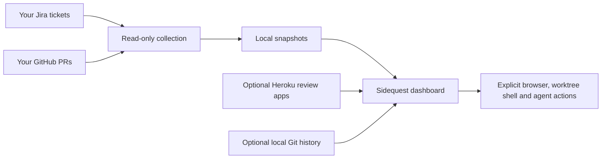

# Sidequest

Your terminal quest log for Jira tickets, GitHub pull requests and the work between
them. Sidequest shows whose turn it is, what changed, and what needs attention.
It also bundles optional agent skills and scripts for planning, local worktrees,
QA screenshots, review feedback and preparing PRs.

## Minimum requirements

For the GitHub + Jira dashboard, you need:

- A macOS or Linux terminal with Python 3.9+.
- Git and the GitHub CLI (`gh`), signed in with your own account.
- Your Jira site/email settings and your own API token in `SIDEQUEST_JIRA_TOKEN`.
- zsh is required when using the Herdr integration (already included on macOS).

Curses and SQLite are included with the supported Python installation; there are
no pip packages or separate database server to install for Sidequest.

**You do not need tmux, Neovim, `glow`, or custom commands such as `edge` and
`nvimc`. No macOS Keychain or clipboard setup is required for the dashboard.**
You can use your normal shell, editor and browser. Opening ticket/PR links uses
the operating system's default browser, or the command in `workspace.browser`.

An AI assistant is required only when you choose to run an agent workflow; its
CLI is configurable. Chrome, Chromium or Edge is required only for automated QA
screenshots, without any custom browser alias. Heroku authentication is used only
for the Heroku integration. Docker, Rails and application test tools belong to
the project you are working on and are not dashboard requirements.

On systems without macOS `pbcopy`, use `./bin/sidequest --standup` to print the
standup for normal terminal copying. The demo works without service credentials.

## Try it first

You need Python 3.9+ and a macOS or Linux terminal. The application uses only
Python's standard library; there is nothing to install with pip.

```sh
git clone https://github.com/Jackson201325/sidequest.git
cd sidequest
./bin/sidequest --demo
```

The demo contains fictional tickets and uses an in-memory database. No accounts,
network access or agent installation are needed. Use `j/k` to move, Enter for
details, `1`–`4` for lanes, `?` for help and `q` to quit.

To print the demo in a regular terminal:

```sh
./bin/sidequest --demo --list
```

## How it works

Sidequest runs on your computer and contacts your services directly. There is no
shared Sidequest account, hosted backend or server to deploy. Each downloader
supplies their own credentials and can see only what those accounts can access.



There are three parts:

| Part | What it does | Required for the dashboard? |
| --- | --- | --- |
| `bin/sidequest` | The interactive dashboard and text/standup views | Yes |
| `bin/sidequest-data` and the `sidequest/` package | Collect service data, normalize it and keep local snapshots | Yes; already bundled |
| `agents/skills/` and workflow scripts | Start/planning, local worktrees, QA, shipping preparation and feedback | Optional |

The dashboard reads local snapshots on startup. Use `--refresh` or press `r` to
load current Jira and GitHub evidence. Configured Heroku status can load separately.
If a source fails, its last good data and timestamp remain visible with an error;
failure never becomes an apparently successful empty queue.

All dashboard helpers are bundled. Scripts from another checkout, private agent
skills and personal shell aliases are not needed. Additional tools are tied to
the particular action you choose:

| Action | Tools it needs |
| --- | --- |
| GitHub + Jira dashboard | Python, Git, gh, and your Jira API token |
| Create/open a worktree | Git and your normal terminal shell; tmux is not required |
| Run an agent workflow | Your chosen agent CLI, configured with workspace.agent_command |
| Capture QA screenshots | Chrome, Chromium or Edge and your test application's setup |
| Inspect Heroku review apps | Heroku CLI login or an explicit API token |
| Run application tests | That application's own tools; Sidequest does not supply a Docker stack |

## Connect your own accounts

Start with the services you use. With no configuration, the live queue is empty
and makes no service requests.

```sh
mkdir -p ~/.config/sidequest
cp config.example.json ~/.config/sidequest/config.json
```

Open `~/.config/sidequest/config.json` in your editor. Replace the placeholders and
remove sections you do not use. This is a minimal Jira + GitHub example:

```json
{
  "identity": {
    "display_name": "Your Name",
    "git_author": "Your Git Author Name",
    "timezone": "UTC"
  },
  "jira": {
    "site": "https://your-company.atlassian.net",
    "email": "you@example.com",
    "projects": ["APP"]
  },
  "github": {
    "repository": "your-org/your-application",
    "username": "your-github-login"
  }
}
```

Choose the repository whose pull requests you want in your queue. Jira and GitHub
work independently: keeping just one service section is fine.

### GitHub

Install the [GitHub CLI](https://cli.github.com/), then sign in with your account:

```sh
gh auth login
gh api user --jq .login
```

Set `github.repository` to `owner/repository`. Set `github.username` to your login;
if omitted, PR discovery uses the currently authenticated gh user. A configured
username is also useful for identifying your authored PR commits.

When a PR or branch name has no ticket key (a hotfix, for example), link it yourself.
`github.pr_tickets` maps PR numbers and `github.branch_tickets` maps branch names to
a ticket. A link wins over a key in the name, joins the PR to that ticket's row, and
selects that worktree for the ticket. Links do not change status or ownership.

```json
"github": {
  "pr_tickets": {"2115": "APP-807"},
  "branch_tickets": {"hotfix/gift-card-prices": "APP-807"}
}
```

### Jira

Set `jira.site`, `jira.email` and, optionally, `jira.projects`. Create a token in
your [Atlassian account's security settings](https://id.atlassian.com/manage-profile/security/api-tokens)
with access to read the projects you want. Supply it to the shell where Sidequest
will run. This Bash/zsh example hides input and keeps the token out of history:

```sh
printf 'Jira API token: '
read -r -s SIDEQUEST_JIRA_TOKEN
printf '\n'
export SIDEQUEST_JIRA_TOKEN
```

The variable lasts for that shell session. Re-enter it in a new terminal or use
your own secret manager. Sidequest reads exported variables; it does not load
`.env` files automatically. Do not put the token in config.json or on GitHub.

`jira.account_id` can be omitted: Sidequest reads it from Jira's `/myself` endpoint.
For scoped API tokens, add your site's `jira.cloud_id` so the adapter can use the
Atlassian API gateway. A missing or rejected token leaves cached data intact.


#### Starting tickets (optional)

Sidequest reads Jira only, with one opt-in exception: moving a ticket you start to your
board's start status. Set `jira.start_status` (for example `In Dev`) to turn it on,
`jira.start_from` to the comma-separated statuses that move without asking (for example
`Ready for Dev, Fixing Revisions`) and `jira.start_ask` to those that need a yes (for
example `Backlog, Blocked`). Any other status, such as review or QA, never moves.
`sidequest-data jira-start APP-123 [--yes] [--dry-run]` prints `MOVED`, `ALREADY`, `ASK`,
`SKIPPED` or `WOULD MOVE`; Space n and the sidequest-start skill use it. On a ticket in a
`jira.start_ask` status, Space n first asks: move it and open the worktree, only open the
worktree, or Esc to cancel. Your token needs permission to transition issues.

`sidequest-data ticket APP-123 --attachments [DIR]` downloads every attachment into the
ticket folder's attachments/ (or DIR). `workspace.copy_files` (space-separated, for
example `.env config/master.key`) lists local files that a newly created worktree gets
from the main checkout; existing files are never overwritten and symlinks are skipped.
Space n names the branch `fix/` for a Jira Bug and `feature/` otherwise. Inside tmux it
then selects the ticket's window, or creates one named after the key, and switches to it;
in a plain shell it opens the worktree in this terminal. The CLI `--open` always opens a shell.

The standup reads and updates daily reports (`YYYY-MM-DD.md`) in `workspace.reports_dir`,
or `reports/` beside the snapshots folder when it is not set. `sidequest --report` shows the
newest one through `$PAGER` (`less -R` by default) and says when it is not today's. A project
can replace that view with its own program: `workspace.report_command` runs instead, with the
other arguments passed on (`sidequest --report --refresh` runs `COMMAND --refresh`).

### Heroku, optional

Install the [Heroku CLI](https://devcenter.heroku.com/articles/heroku-cli), run
`heroku login`, and put the review-app pipeline ID in `heroku.pipeline`.
Sidequest reads the token from that CLI login or `SIDEQUEST_HEROKU_TOKEN`.
A blank pipeline disables Heroku and avoids any Heroku credential lookup.

### Local Git and plans, optional

Set `workspace.repository` to the absolute path of the application checkout you
work on. Set `identity.git_author` to your Git author name to filter local commits.
Local history reads never fetch, reset or switch your repository.

Use Jira keys such as `APP-123` in PR titles and ticket branches so sources can be
associated. `workspace.plans_dir` chooses where `APP-123/plan.md` and its QA evidence
live. `workspace.worktrees_dir` optionally chooses where new worktrees are created.
Both belong outside source repositories.

## Your first live refresh

From the Sidequest directory, with the credentials above available:

```sh
./bin/sidequest-data collect --json
./bin/sidequest
```

Or refresh as the dashboard opens:

```sh
./bin/sidequest --refresh
```

For scripting and a standup draft:

```sh
./bin/sidequest --refresh --list
./bin/sidequest --standup
```

The queue includes your assigned open Jira tickets, your authored open PRs and
Jira details for tickets named in those PRs. It separates work into:

| Lane | Meaning |
| --- | --- |
| Needs me | Current evidence points to your next action |
| Waiting | Jira assignment or a handoff points to another owner |
| Clarify | The available evidence does not establish who acts next |

Activity shows Jira/GitHub events, including Jira status moves and assignee changes.
Work log shows dated commit evidence. Plan (`p`)
shows planning sections from the external plan file; Updates (`d`) shows explicit
Updates, implementation progress and recorded QA/test results from that same file.
Nested sections stay with their parent, fenced examples stay literal, and unknown
headings remain in Plan, except open-question sections, which show in Questions.
Editing the file refreshes both views without rewriting it.

Questions (`c`) shows the ticket's decision record, `questions.md` in the same
ticket folder: what is not asked yet, what waits for an answer, and each answer with
the decision it led to. Only `sidequest-data questions APP-123 add|asked|answer|decision|list`
writes it; the dashboard never edits it. Meetings (`m`) shows `meetings.md` from the
ticket folder, newest meeting first. Sidequest does not record meetings; any notes
tool that appends `## <date> · <scope>` sections to that file works. Overview shows
the unanswered-question count and the latest meeting.

For a ticket with a local worktree, the card adds a Local line from local Git only:
commits not pushed, uncommitted files, commits behind the base ref (last fetch) and
the QA screenshot state when the branch changes UI files. Your own tickets with
missing or stale screenshots get a "Space s → QA locally" hint.
Flow summarizes the current workflow stage.
Standup drafts from evidence rather than estimating hours or inventing progress.

WAIT counts Monday–Friday, 09:00–17:00 in your configured timezone; one day means
eight working hours. Nights and weekends are excluded, holidays are not. Jira
status history and first assignment supply the clock; absent history uses a
labeled observation fallback. The Refreshed timestamp describes data freshness.

## Optional skills and workflow scripts

The dashboard works without installing skills. Use these when you also want an
agent to help perform the work. They follow the target repository's instructions,
test commands, branch conventions and environment booking rules.

| Skill | Use it for |
| --- | --- |
| `sidequest-start` | Read a ticket, reuse/create its worktree and write a plan |
| `sidequest-qa-local` | Check acceptance criteria and capture local QA evidence |
| `sidequest-qa-review-app` | Check an open PR on its Heroku review app |
| `sidequest-ship` | Review, test, prepare scoped commits and a PR |
| `sidequest-feedback` | Read complete review threads, fix issues and draft replies |
| `sidequest-triage` | Investigate a supplied error and reproduce it with fixtures |

In the dashboard, Space `s` runs a selected workflow through your configured agent
in the ticket's local worktree. In shell mode, the dashboard hands its terminal to
the agent and returns when it exits. The command defaults to `claude`; set
`workspace.agent_command` to `codex`, or another CLI command that accepts the prompt
as its final argument. Those instructions are bundled; global skill installation
is not required. tmux uses windows/panes; Herdr uses tabs/panes in the caller's workspace.

To use your own workflows instead, set `workspace.agent_tasks` to a list of
`{"label", "prompt", "skill"}` objects. `{key}` in the prompt becomes the ticket key, and
`skill` (optional) is a Markdown file the agent is pointed at: the prompt ends with
`(use the NAME skill: PATH)`. The list replaces the bundled presets; "Custom prompt..."
stays last. For example:

```json
"agent_tasks": [
  {"label": "Ship the ticket", "prompt": "ship {key}", "skill": "~/my-skills/ship.md"},
  {"label": "Review the branch", "prompt": "review the branch for {key}"}
]
```

For direct use in Codex or Claude Code, preview an installation, then install:

```sh
# Codex; use ~/.claude/skills instead for Claude Code
./bin/sidequest-data skills --dest ~/.codex/skills
./bin/sidequest-data skills --dest ~/.codex/skills --apply
./bin/sidequest-data skills --dest ~/.codex/skills --check
```

Each installed skill is a short stub with the skill's name and description. It tells
the agent to run `sidequest-data skill NAME` (for example `skill ship`) and follow
what it prints, so the steps always come from this clone and from the current project.
The installer binds the stubs to this clone's absolute paths. Keep the clone in
place. It detects drift and refuses to overwrite user-edited skills. In a new
agent session, invoke a skill by name, for example `$sidequest-start APP-123`.

### Project additions to a skill

A project adds its own steps without copying a skill: put only the differences in
`~/.config/sidequest/projects/NAME/skills/WORKFLOW.md`, where WORKFLOW is `start`, `ship`,
`feedback`, `qa-local`, `qa-review-app` or `triage`. `sidequest-data skill ship` prints the
generic steps, then a "Project additions" section that wins where the two differ.

Commands also belong in settings rather than in skill text: `checks.test` (it may use
`{files}` for the test files to run) and `checks.lint`. When either is set, or `app` is
configured, `sidequest-data skill NAME` starts with a "Project commands" block naming them
and the `sqapp` booking, and the generic steps refer to it. A replace version is printed as
written, without the block.

When a project's flow differs in structure, write the whole skill instead as
`skills/WORKFLOW.replace.md`. A replace version wins over the generic skill and over any
additions file. Front matter is dropped, and `{{SIDEQUEST_DATA}}` / `{{SIDEQUEST_HOME}}` are
filled in. The file may be a link, for example to a skill kept in another repository.
Space s uses the same text. A project with neither file gets the generic skill.

The helper scripts are available without an agent:

```sh
./bin/sidequest-data ticket APP-123 --json --activity
./bin/sidequest-data branch-name APP-123 --summary "Validate input" --type Bug
./bin/sidequest-data worktree APP-123 --json
./bin/sidequest-data workspace APP-123 --summary "Validate input" --base origin/main
# Repeat with --apply only to create the previewed local worktree
./bin/sidequest-data workspace APP-123 --summary "Validate input" --base origin/main --open
./bin/sidequest-data plan-init APP-123 --summary "Validate input"
./bin/sidequest-data pr-feedback 42 --json --activity
./bin/sidequest-data ship-check --no-fetch --base origin/main --json
./bin/sidequest-data pr-body-check /path/to/pr-body.md
```

Run Git/PR checks inside the application's ticket checkout, invoking Sidequest's
helper by its absolute path if needed. Use the target project's actual base ref.
The workspace helper uses live Git state, previews by default, reuses existing
checkouts, and never removes worktrees or copies secret files.

### Work in a plain terminal

You do not need tmux. Set `workspace.repository` to your application checkout.
In the dashboard, Space `n` creates or reuses the selected ticket's worktree and
opens your normal shell there. `w` opens a shell in an existing ticket worktree.
Run your editor, test commands or coding assistant as usual. Type `exit` to return
to Sidequest. Starting a local worktree does not move the Jira ticket.

The CLI's `workspace ... --open` command creates/reuses the checkout and opens a
shell there as well. It uses `workspace.base_ref` (default `origin/main`) unless you
pass --base. A child program cannot change the caller's shell directory; --open
therefore starts a shell in the worktree. To change your current shell instead,
omit --open and use `cd` with the printed DIR path.

Sidequest does not bundle a company Docker stack, shared database booking service,
automatic worktree cleanup, Jira custom-field mapping or board-specific status
transitions. The skills use the project's own setup and ask before remote actions
unless already authorized. Nothing merges, deploys or sends messages on refresh.

### Work in Herdr

Herdr 0.9.5 is supported through the same terminal interface as shell/tmux. Install
it with `brew install herdr` on macOS, or follow [Herdr installation](https://github.com/herdrdev/herdr#install).
Install zsh if it is absent (`brew install zsh` on macOS or your Linux package
manager). In Herdr's `config.toml`, set `[terminal]` `default_shell` to your zsh
executable, such as `/bin/zsh`. Sidequest also requires zsh for foreground Herdr
worktree shells and reports an error if it cannot find it.
Set your account settings as described in [Connect your own accounts](#connect-your-own-accounts).
For worktree/agent actions, set `workspace.repository` to your local application
clone and choose `workspace.agent_command` if you use an assistant. Start `herdr`,
then export your Jira token **inside the pane where Sidequest will run**. Starting
a new client does not retrofit new variables into an existing server's processes.
Run Sidequest there:

```sh
SIDEQUEST_TERMINAL=herdr /path/to/sidequest/bin/sidequest --refresh
```

The public entry point is `bin/sidequest`. A `sidequest-herdr` shortcut is a
user-owned wrapper outside this repository. Each adopter supplies their own
accounts; Herdr keybindings and theme remain their local settings.

For an 80-column terminal, collapse Herdr's sidebar so Sidequest has at least
64 columns. You can merge this into Herdr's existing config sections:

```toml
[terminal]
default_shell = "/bin/zsh"

[ui]
sidebar_start_collapsed = true
```

If the dashboard is monochrome, check whether `NO_COLOR` is set. To enable colors,
run `unset NO_COLOR` in that pane and restart Sidequest. Explicit `NO_COLOR` is
still supported for users who prefer monochrome output.

`w` focuses a matching worktree tab, creating a tab when needed. Space `s` starts the configured assistant in a new
pane/tab. Space `n` and CLI `workspace --open` keep their foreground shell behavior;
exit returns to the dashboard. Herdr never creates Git worktrees on Sidequest's
behalf.

With `workspace.terminal` set to `herdr`, `sidequest up` lays out Herdr the way it lays out tmux: each
project (and each personal session) becomes a workspace in your default Herdr session, labelled with
`workspace.tmux_session`, and each window becomes a tab, in the same order. Tabs are reused by label and
never closed; the person's own tabs stay between the worktrees and the end windows. When no Herdr server
runs, Sidequest starts one in the background (like `tmux new-session -d`), then attaches `herdr` in your
terminal, or focuses the workspace when you are already in Herdr. `--when-due`, `--all`, `-r` (closes the
workspace), `sidequest start`, the merged-worktree cleanup, the project overview and `workspace.launch`
`session` all work the same way. One difference: a window's `command` (then `keys`) is typed into the
tab's shell, so the shell always stays when the command ends, as with `stay`.

`workspace.terminal` accepts `auto` (default), `shell`, `tmux` or `herdr`.
`SIDEQUEST_TERMINAL` overrides it for one invocation. Auto prefers active tmux,
then active Herdr, then shell. This preserves tmux when both contexts are present;
explicitly select Herdr when nesting it inside tmux. Managed modes require their
actual caller context; installing a binary alone does not enable controls.

Herdr controls stay within the caller's workspace and use discovered IDs. A
reported error may follow a partially applied layout change or admitted command;
inspect the session before retrying. Large prompts use mode-600 launch files in
the external Sidequest state directory (`launches/`), deleted when consumed. An
uncertain submission leaves its file for inspection; remove an unused file only
after confirming that the command is not queued/running. No prompt enters this
repository or is placed directly on Herdr's shell input line.

Herdr itself is a multiplexer; it does not connect Jira/GitHub or populate tickets.
The dashboard needs the account configuration above. Demo launchers can provide
fictional tickets, but do not automatically connect your real accounts. If a
previously configured integration becomes unconfigured, refresh keeps its cached
data and original source time and reports the missing setting. A successful live
empty response still clears old data normally.

### QA screenshots

Start the target app with its documented command and install Chrome, Chromium or
Edge. Put a specification at the ticket's external `APP-123/qa/shots.json`:

```json
{
  "base_url": "http://localhost:3000",
  "shots": [{
    "name": "01-home",
    "path": "/",
    "caption": "Open the home page and check the welcome message",
    "steps": [{"expect_text": "Welcome"}]
  }]
}
```

Adapt the paths, text and clicks to your app. If login is needed, supply your own
local test account: `qa.email` in the settings and `SIDEQUEST_QA_PASSWORD` in the
environment (the password is never a setting). No default login is supplied. `qa.browser`
selects a browser executable when discovery is insufficient. A shots.json without
`base_url` uses `app.url`, else `http://localhost:3000`.

```sh
./bin/sidequest-data qa-shot APP-123
./bin/sidequest-data qa-shot APP-123 --pr-markdown
./bin/sidequest-data review-app APP-123 --json
./bin/sidequest-data qa-shot APP-123 --review-app
```

`review-app 123` (a bare number) works only when `jira.projects` names exactly one
project. Without a key or `--pr`, it uses the ticket in the current branch name. It
searches open PR titles for the key, then the newest 500 open PR branches.

Review-app login uses `SIDEQUEST_REVIEW_EMAIL` and `SIDEQUEST_REVIEW_PASSWORD`,
only on the HTTPS Heroku host discovered for that PR. Screenshots and manifests
stay in `qa/` or `qa-review/`; failed checks save separate evidence in `failures/`.
No screenshots are uploaded automatically. Re-capture when UI changes make them stale.

### Code map (for development)

```sh
./bin/sidequest-map.py            # prints the path of the HTML page; open it in a browser
```

The page shows each module by layer, who calls whom, file writes, config and
environment reads and external programs. It only reads the source.

## Keys

| Key | Action |
| --- | --- |
| `j/k`, arrows | Move through tickets or scroll details |
| `h/l`, Enter | Switch between the list and details |
| `1`–`4` | All, Needs me, Waiting, Clarify |
| `/` | Search |
| `a/p/d/c/m/v/s/f/u` | Activity, Plan, Updates, Questions, Meetings, Overview, Work log, Flow, Standup |
| `o/O` | Choose or reverse a sort |
| `+/-`, `=` | Resize sections or reset the split |
| `r`, `e` | Refresh Jira/GitHub, or optional Heroku status |
| Space `j/o` | Open the ticket or PR in your configured/default browser |
| `w` | Open the worktree through the selected shell, tmux window or Herdr tab |
| Space `n` | Create/reuse a local ticket worktree and open a shell there |
| Space `s` | Run a bundled workflow or custom prompt with the configured agent |
| `y` | Copy standup with macOS pbcopy; --standup prints it on any platform |
| `?`, `q` | Help, quit |

## Shared local app (sqapp)

Some projects run one local app (for example a Docker Compose stack) that every
worktree shares. `bin/sqapp` lets one worktree at a time use it, so two people or
agents never switch the app under each other. It is optional; configure `app`:

```json
"app": {
  "url": "http://localhost:3000",
  "switch_command": "make up",
  "current_command": "docker inspect my-web --format '{{range .Mounts}}{{if eq .Destination \"/app\"}}{{.Source}}{{end}}{{end}}'",
  "running_command": "docker inspect -f '{{.State.Running}}' my-web",
  "required_files": ".env"
}
```

| Command | Action |
| --- | --- |
| `sqapp` | Book the app for this worktree and run `switch_command` there (skipped when it already runs this worktree) |
| `sqapp --wait` | Same, but wait up to `wait_minutes` (default 9) for the current user |
| `sqapp --release` | Free the app when you finish testing |
| `sqapp --status` | Who has it booked and which worktree it runs |
| `sqapp --force` | Take a live booking (for people, not agents) |

Exit code 75 means another worktree has it; retry later. A booking expires
`ttl_minutes` (default 30) after its last `sqapp` call. Commands run without a
shell, in the worktree. `current_command` prints the folder the app runs;
`running_command` must exit 0 and not print `false` when the app is up. The lock
lives in the Sidequest state folder, so each configuration has its own booking.
The dashboard header shows `App APP-12 · idle 2m` or `App free` when `app` is set.
`sidequest-data app` is the same command.

## Configuration and local storage

### Adopt a project

Everything Sidequest knows about you and your projects lives outside this repository:

```
~/Documents/sidequest/                    the app: generic, no project values
~/.config/sidequest/config.json           you: identity, shared by every project
~/.config/sidequest/projects/NAME/
    config.json                           the project: Jira, GitHub, repo, worktrees, app, qa, checks, credentials
    skills/                               optional: WORKFLOW.md additions or WORKFLOW.replace.md
macOS Keychain (or your environment)      secret values only
~/.local/{share,state}/sidequest/projects/NAME/   data, snapshots and the app booking (written by Sidequest)
```

1. `sidequest-data project init NAME --repo PATH` writes the profile from `config.example.json`,
   with the repository, worktrees folder, tmux session and credential references filled in.
2. Fill in the sections you use; an empty value keeps that part off.
3. Store each secret you need with the `security add-generic-password …` command that init printed.
   `credentials` names where a secret lives (`keychain:SERVICE`, `keychain:SERVICE/ACCOUNT` or
   `env:NAME`) and refuses anything else, so a secret can never be written to the file. An
   environment variable (`SIDEQUEST_JIRA_TOKEN`, `SIDEQUEST_REVIEW_EMAIL`/`_PASSWORD`,
   `SIDEQUEST_QA_PASSWORD`) still wins over the reference.
4. `sidequest-data project check`, inside the project, lists each part as OK, MISSING, FAIL or OFF
   (repository, identity, Jira and its token, GitHub sign-in, Heroku, shared app, checks, logins,
   project skills) and exits 1 on a FAIL. It never prints a secret.
5. Optional: add `skills/WORKFLOW.md` or `skills/WORKFLOW.replace.md` (see "Project additions to a skill").

`sidequest-data project wiring` shows everything the project plugs into Sidequest, in one list:

- Each command Sidequest runs (`checks.*`, `app.*`, `workspace.report_command`, `agent_command`,
  `browser`, `on_up` hooks, window commands), and whether its program exists (OK or FAIL).
  Window `keys` show as TYPED, because aliases cannot be checked.
- Each skill, and the file that wins: REPLACE, ADDS (generic + additions) or GENERIC. A link is
  followed to the real file (`->`). It also says where the stubs are installed (Claude Code, Codex).
- Each secret, as its reference only.

It exits 1 when a command or file is missing. It only reads.

### Prepare the workspace (`sidequest up`)

`sidequest up` collects the project's sync data, fetches origin and creates a worktree for each
sync ticket (`sync.tickets_jql`) and each of your open PRs that has none, reusing existing
branches (`fix/` for a new Bug branch, `feature/` otherwise) and copying `workspace.copy_files`.
Tickets with a merged PR are skipped. Then the tmux session (`workspace.tmux_session`) gets one
window per worktree, in the order the tickets were first assigned to you (remembered after a ticket
leaves your list), the main checkout first, plus `workspace.windows`:

```json
"windows": [
  {"name": "queue", "command": "sidequest", "at": "start", "stay": true},
  {"name": "report", "command": "sidequest --report", "at": "end"},
  {"name": "editor", "keys": "nvim", "at": "end"}
],
"on_up": ["~/project/tools/sync-agent-rules -q"]
```

`stay` leaves a shell when the command ends; `keys` is typed into a new window's shell once, so
aliases work. Windows are reused and moved, never closed; your own windows stay, after the
worktrees. `on_up` commands run last, then the session is attached (`--no-attach` leaves it).
After a successful fetch it also keeps branches current, the way most people would by hand:
each branch takes new commits from its own origin branch (fast-forward only), local `main` follows
`origin/main`, a branch never pushed is rebased onto the base, and a pushed branch that is behind
the base is listed (`--update`, or `sync.update: on`, merges the base in). A worktree is left alone
while a merge or rebase is in progress, while the app is booked for it, while an agent works in
it, or when its branch diverged from its origin branch. Uncommitted work is autostashed, a failed
rebase or merge is aborted, and nothing is ever pushed. `--dry-run` prints the plan, the updates
("would …"), windows and hooks without changing anything; `--offline` (`-n`) uses the last
collected data and neither fetches nor updates. `-u` is `--update`. `-r` (`--rebuild`) closes the
tmux session first and builds it again. This stops what runs in its windows, so save first.
Short options combine: `sidequest up -rn`.

`sidequest up --all` prepares every project in turn, each in its own tmux session (the project's
tickets are that session's windows), then attaches to the first. Switch projects with tmux's
session list (prefix `s`).

`--when-due` syncs only when the last sync is older than `sync.every_minutes` (for example
`"120"`). Before that, it attaches to the open session, or builds a missing one without network.
A project without `sync.every_minutes` always syncs. `sidequest up` without `--when-due` always
syncs. To get this whenever a terminal opens, use it as the terminal's start command, then fall
back to a shell. In Alacritty:

```toml
[terminal.shell]
program = "/bin/zsh"
args = ["-lc", "sidequest up --all --when-due; exec zsh -l"]
```

Detaching (prefix `d`) returns to the shell.

### Personal sessions (dotfiles, notes)

Windows that belong to no project, such as your editor or shell configuration, get their own tmux
session (a Herdr workspace with `workspace.terminal` `herdr`). Put them in the shared `~/.config/sidequest/config.json` under `sessions`: each name is a
session, and its windows use the `workspace.windows` fields (`name`, `command`, `cwd`, `at`, `stay`,
`keys`; a missing `cwd` is your home folder):

```json
"sessions": {
  "dotfiles": [
    {"name": "nvim-config", "cwd": "~/.config/nvim", "command": "nvim", "stay": true},
    {"name": "dotfiles", "cwd": "~/dotfiles", "command": "nvim", "stay": true}
  ]
}
```

Every `sidequest up` (and so `up --all` and plain `sidequest` with `workspace.launch` `session`) builds
these sessions too, without network: windows are reused by name and never closed, like a project's.
`--dry-run` lists them. A name that the project's own `workspace.tmux_session` uses is skipped. Switch
to one with tmux's session list (prefix `s`).

To make plain `sidequest` do this, set `workspace.launch` to `session` (default `dashboard`), usually in
the shared `~/.config/sidequest/config.json` so every project gets it:

```json
"workspace": {"launch": "session"}
```

Then `sidequest` with no arguments, in a terminal outside tmux and Herdr, runs `sidequest up --when-due`
(`--all` when no project is selected). Inside tmux or Herdr, with arguments, without a terminal, or when
`workspace.terminal` (or `SIDEQUEST_TERMINAL`) is `shell` or `herdr`, it opens the dashboard as before,
so the session's own Sidequest window never loops. Herdr sessions are not opened this way yet.

Before creating anything, it can remove worktrees whose PR merged (`sync.cleanup`: `ask`, the
default, asks per worktree in a terminal; `on` removes; `off` skips; `--cleanup` considers them
when off and `--yes` answers yes). A worktree is removed only when you are not in it, the app is
not booked for it, no agent works in it, it has no uncommitted or untracked files, every commit of
its branch is in the merged PR's head, and GitHub, asked at that moment, still reports the PR as
merged with that head. Then its window closes, `git worktree remove` runs without `--force`, and
the local branch is deleted. The main checkout is never removed; `--offline` and a run without a
terminal (unless `--yes`) remove nothing.

### Start one ticket (`sidequest start`)

`sidequest start APP-123` does what Space `n` does in the dashboard, from a shell or an agent. It
moves the ticket to `jira.start_status` (`jira.start_from` statuses move; `jira.start_ask` statuses
need `-y`; `--no-move` leaves Jira alone), creates or reuses its worktree (`--prefix
fix|feature|hotfix|chore` for a new branch), runs `sidequest up -n --no-attach` so its window
exists, selects that window and prints `DIR <worktree>`. A bare number takes the first of
`jira.projects` (`sidequest start 123` → `APP-123`). A refused move is noted; the worktree is still
made.

### Several projects

Each project gets a profile: `~/.config/sidequest/projects/NAME/config.json` (NAME uses
lowercase letters, digits, `-` and `_`). `~/.config/sidequest/config.json` keeps the settings
every project shares, such as `identity`; a profile's sections are applied over it, key by key.
Sidequest chooses the project in this order:

1. `--project NAME` on any command (`sidequest`, `sidequest-data`, `sqapp`) or `SIDEQUEST_PROJECT`.
2. The profile whose `workspace.repository` or `workspace.worktrees_dir` holds the current
   folder (the deepest match), so agents and `sqapp` inside a worktree need no flag.
3. The only profile, when there is one.

With several profiles and none chosen (for example in `~`), `sidequest up` and `sidequest start`
do not guess: they name the projects and exit 2. In a terminal, `sidequest` and `sidequest up`
open the project overview instead. `sidequest projects` opens it from anywhere:

```
 > acme          tmux: running   18 windows  synced 08:31
                 repo ~/code/acme
                 13 worktrees · app booked: APP-766
   globex        tmux: none                  synced never
```

`j`/`k` choose a project. Enter or `a` attaches its tmux session, or builds it with
`sidequest up -n` when there is none. `u` runs `sidequest up`. `r` runs `sidequest up -r` after
it asks. `d` runs a dry run. `s` asks for a ticket and runs `sidequest start`. `q` opens the
project's dashboard. `c` runs `sidequest-data project check`. Esc quits. Without a terminal,
`sidequest projects` prints the list. The overview only reads: each project's settings, its
snapshot time, its app booking, `git worktree list` and `tmux list-windows`.

Each profile keeps its own data, snapshots and app booking in
`~/.local/{share,state}/sidequest/projects/NAME/`. Commands that Sidequest starts keep its
project. `sidequest-data project` shows the selected project and its folders. A profile
folder can also hold `skills/WORKFLOW.md` add-ons (see "Project additions to a skill").
Without a `projects/` folder, everything works as before with one `config.json`.

`SIDEQUEST_CONFIG=/absolute/path/config.json` selects one config file and ignores profiles. Every
setting can also come from an environment variable named `SIDEQUEST_<SECTION>_<KEY>`,
which wins over the file: `SIDEQUEST_JIRA_SITE`, `SIDEQUEST_GITHUB_REPOSITORY`,
`SIDEQUEST_APP_SWITCH_COMMAND` and so on. `SIDEQUEST_JIRA_PROJECTS` takes a
comma-separated list; `SIDEQUEST_GITHUB_PR_TICKETS` and `..._BRANCH_TICKETS` take JSON.
An unknown `SIDEQUEST_<SECTION>_...` name is an error, so typos do not pass silently.
`SIDEQUEST_JIRA_TOKEN` and `SIDEQUEST_QA_PASSWORD` stay credentials, never settings; the file
refuses any key named like a token, password, secret or API key. `SIDEQUEST_DATA_DIR` and
`SIDEQUEST_STATE_DIR` move the cache and state folders, so a small wrapper script per
project can keep projects apart:

```sh
#!/bin/sh
export SIDEQUEST_JIRA_SITE=https://other-company.atlassian.net SIDEQUEST_JIRA_PROJECTS=OPS
export SIDEQUEST_GITHUB_REPOSITORY=other-org/app
export SIDEQUEST_DATA_DIR=~/.local/share/sq-other SIDEQUEST_STATE_DIR=~/.local/state/sq-other
exec ~/Documents/sidequest/bin/sidequest "$@"
```
 The
`XDG_CONFIG_HOME`, `XDG_DATA_HOME` and `XDG_STATE_HOME` conventions are supported.
`config.example.json` lists the available settings, including optional browser,
tmux session, local repository and artifact folders. The default timezone is UTC.

| Content | Default location |
| --- | --- |
| Configuration | `~/.config/sidequest/config.json` |
| UI cache | `~/.local/share/sidequest/tickets.sqlite3` |
| Snapshots | `~/.local/state/sidequest/snapshots/` |
| Plans and QA evidence | `~/.local/state/sidequest/tickets/APP-123/` |
| QA browser profile | `~/.cache/sidequest/qa-browser-profile/` |

`--data-dir` and `--snapshots` override dashboard storage. `workspace.plans_dir`
or `SIDEQUEST_TICKETS_DIR` overrides the plans/QA folder. Snapshots and screenshots
can contain private work information and remain outside the source repository.
Tokens are read from your environment or CLI login store and are not stored in
snapshots. The project contains an example configuration, never your live login.

`--update-report` updates the Standup section of a report you supply at
`reports/YYYY-MM-DD.md`, beside the snapshots directory. It preserves written text,
adds new Today items and saves a backup. If the report is missing it prints a draft
and exits 3. There is no scheduler or check-in service.

## Troubleshooting

| Symptom | What to check |
| --- | --- |
| Empty queue | Configure at least one service, then run --refresh; check the selected project/repository and authenticated user |
| Jira login error | Export SIDEQUEST_JIRA_TOKEN in this shell; verify jira.email, site and, for scoped tokens, cloud_id |
| GitHub login/access error | Run gh auth login; verify the repository and account permissions |
| "GitHub CLI (gh) is not installed" | Install gh and put it on PATH, then run gh auth login |
| DNS, TLS or network error | Check your network, VPN and certificates; Jira and Heroku report these separately from login errors |
| "timed out without an answer" | Run the same gh or heroku command in a terminal; it may be waiting for a prompt |
| "the service did not answer in time" | Jira was slow or unreachable; try again in a few minutes |
| "server error" or "rate limited" | The service is busy or failing; wait a few minutes, then press r |
| "Collection failed (…)" or "request failed" | Run ./bin/sidequest-data collect --json in a terminal; it prints the error itself |
| "Jira issue … moved to …" | The ticket has a new key; use that key |
| "The Jira site refused the token" | With both jira.site and jira.cloud_id set, the site refused the token and the cloud gateway's answer is shown. A scoped token only works on the gateway, so its answer is the real one; otherwise renew SIDEQUEST_JIRA_TOKEN |
| Old rows after a failed refresh | Cached data is being retained; the error and source timestamp explain why |
| No local work log | Configure workspace.repository (or SIDEQUEST_REPO) and identity.git_author; branch history compares with workspace.base_ref |
| No Heroku status | Configure the correct pipeline and check the account's access; provisioned does not always mean Web up |
| Missing browser or QA login | Set qa.browser and provide the appropriate local/review test credentials |
| Skill drift | --check reports differences; preserve user edits rather than overwriting them |
| Native Windows | Use a macOS or Linux environment; native Windows curses is unsupported |

## Development and limits

Workspace actions share a coordinator with separate Git planning/execution and
shell/tmux/Herdr adapters. See [ARCHITECTURE.md](ARCHITECTURE.md) for module ownership
and [integration specs](specs/workspace-integrations.md) for behavior and planned
Herdr/deployment integration requirements. Executable specs run in the normal
test suite.

```sh
./bin/check
```

Checks use temporary folders, fictional identities, mocked services, temporary Git
repositories and a real pseudo-terminal for curses input. Optional browser fixture
tests run when `SIDEQUEST_QA_BROWSER` is provided directly to `test_qa_shot.py`.
See [DEVELOPMENT.md](DEVELOPMENT.md) and [HARDENING.md](HARDENING.md).

PR collection requires fewer than 100 authored open PRs; reaching the limit fails
explicitly and preserves the previous source. GitHub activity and unresolved threads
are paginated; reaching the REST API's 250-commit PR cap also fails explicitly.
Local history covers 90 days. Common Jira status names are recognized; custom
workflows retain an honest ownership/clarification fallback. Live service access
and project-specific application commands must be checked in each adopter's setup.
